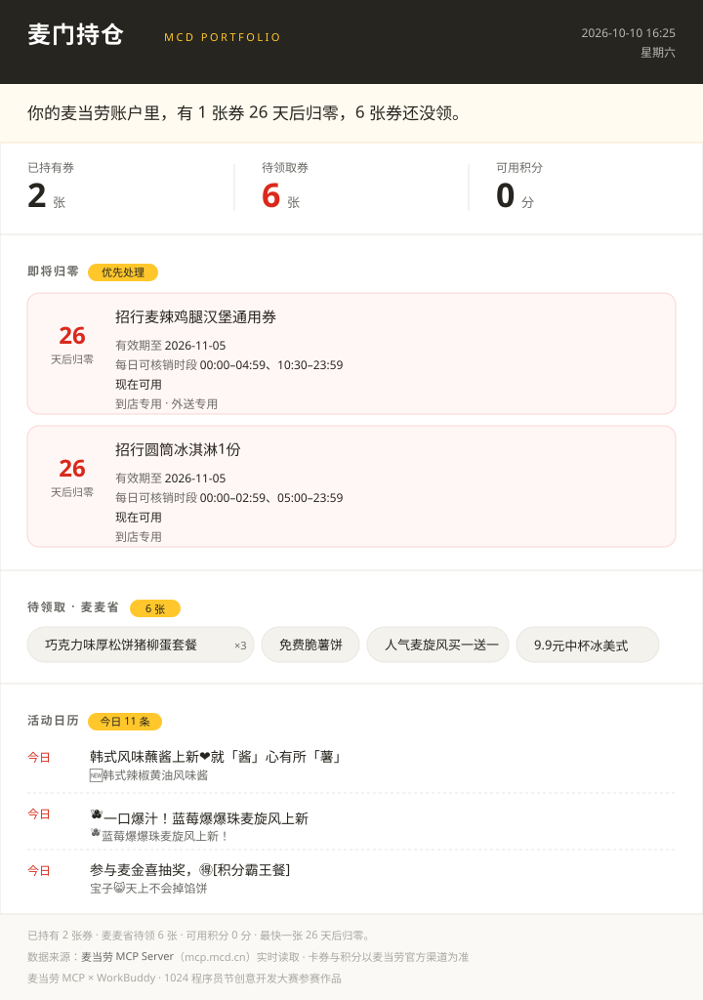

# 麦门持仓 · mcd-portfolio

> 你的麦当劳账户里，有几张券正在悄悄过期？

一条命令，把散落在麦当劳 App 各处的**优惠券、麦麦省待领券、积分和当月活动**
拉齐，算清哪些钱正在白白流失，输出一张可以直接截图的持仓卡。

```
你的麦当劳账户里，有 1 张券 26 天后归零，6 张券还没领。
```

## 它长什么样



> 这是一份真实运行结果（2026-10-10 实测）。运行后会生成 `card.html`，
> 直接打开、截图即可分享。

同一份结果的完整 HTML 见 [`docs/example-card.html`](docs/example-card.html)。

## 为什么做这个

麦当劳的优惠券资产分散在 App 的不同入口，用户普遍在三种地方白白损失：

| 损失 | 说明 |
|---|---|
| **不知道有券** | 麦麦省的可领券不会自动到账，得主动领。实测一个普通账号的**待领券数量是已持有券的 3 倍**。 |
| **不知道什么时候过期** | 到期日藏在券详情里，过期即作废，一声不响。 |
| **不知道什么时候能用** | 同一张券在一天内的可核销时段是分段开放的，带着"不能用"的券去门店很扫兴。 |

第三点尤其没人讲：麦辣鸡腿堡券的每日可核销时段是 `00:00–04:59` 与 `10:30–23:59`，
也就是 **05:00–10:29 处于空窗**——清晨用不了，反倒是凌晨能用。
圆筒冰淇淋券的空窗则是 **03:00–04:59**。这些时段藏在 MCP 返回的字段里，
官方文档没写，券包界面上也看不到。

## 目标用户

- **每周至少吃一次麦当劳、但从不主动翻券包的人**：说不清自己有几张券、哪张快过期。
- **麦麦省的重度用户**：可领券不会自动到账，需要有人提醒「该领了」。
- **带着券到门店才发现不能用的人**：需要提前知道每张券今天哪个时段才能核销。
- **想把账户状态一键截图分享的人**：朋友圈、寝室群、公司群的传播场景。

> 本项目只做「看清账户」，**不提供下单、支付、代领券之外的操作**。
> 唯一的写操作是经你同意后一键领取麦麦省优惠券。

## 快速开始

### 1. 申请 MCP Token

打开 <https://open.mcd.cn/mcp> → 右上角登录（手机号验证）→ 控制台 → 激活 → 复制 Token。

免费，一分钟搞定。

### 2. 配置 Token

```bash
# macOS / Linux
export MCD_MCP_TOKEN=<你的Token>
```

```powershell
# Windows PowerShell
$env:MCD_MCP_TOKEN="<你的Token>"
```

### 3. 跑

```bash
# macOS / Linux
python3 skills/mcd-portfolio/scripts/mcd_portfolio.py --out card.html
```

```powershell
# Windows PowerShell
python skills\mcd-portfolio\scripts\mcd_portfolio.py --out card.html
```

只用 Python 标准库，**零依赖**，Python 3.9+ 均可。

> 拿不准环境是否就绪时，先跑 `python skills\mcd-portfolio\scripts\mcd_portfolio.py --help`
> （或 `python3 ...`），能打印帮助就说明依赖没问题。

看到这样的输出就成了：

```
[+] 持仓卡已生成：/path/to/card.html
    已持有券 2 张 | 麦麦省待领 6 张 | 可用积分 0 分
    ! 招行麦辣鸡腿汉堡通用券 — 26 天后归零
    ! 招行圆筒冰淇淋1份 — 26 天后归零
```

### 可选参数

| 参数 | 说明 |
|---|---|
| `--claim` | 先领光麦麦省全部可领券，再生成卡片（**写操作**） |
| `--json data.json` | 额外导出结构化数据，方便二次处理 |
| `--out PATH` | 指定卡片输出路径 |
| `--template PATH` | 换用自定义卡片模板 |

## 在 WorkBuddy 里使用

本仓库同时是一个标准 WorkBuddy Skill：

1. 把 `skills/mcd-portfolio/` 整个目录拷到 `~/.workbuddy/skills/` 下
2. 按 `mcp-config.example.json` 配好 `mcd-mcp` 连接器并启用
3. 对 WorkBuddy 说「看看我的麦当劳券」或「给我的麦当劳账户做个体检」

## 一键发布到 GitHub

仓库自带发布工具，不依赖 `gh` CLI，只用 Python 标准库 + 原生 git：

```bash
# macOS / Linux
export GITHUB_TOKEN=ghp_xxx      # 需要 Contents 与 Issues 的读写权限
python3 tools/publish_github.py --dry-run   # 先演练，不改动任何东西
python3 tools/publish_github.py             # 建公开仓库 + 推送
python3 tools/publish_github.py --issue     # 顺便提交参赛报名 Issue
```

```powershell
# Windows PowerShell
$env:GITHUB_TOKEN="ghp_xxx"
python tools\publish_github.py --dry-run
python tools\publish_github.py
python tools\publish_github.py --issue
```

发布前会自动过四道自检，任何一道不过就停手：

1. **必需文件**：5 个参赛文件的文件名逐一核对
2. **密钥扫描**：扫全仓库，发现硬编码 Token 直接中止推送
3. **git 状态**：补上仓库级身份、提交未提交的改动
4. **Token 校验**：调 `/user` 接口确认有效

另外两个细节：推送用的是临时带凭证的远端地址，**推完立刻换回干净地址**，
Token 不会留在 `.git/config` 里；默认**不加** `--force`，远端有他人提交时会停下来问你。

Token 获取：GitHub → Settings → Developer settings → Personal access tokens。

## 依赖的 MCP 工具

| Tool | 用途 |
|---|---|
| `now-time-info` | 服务器时间，倒计时的基准 |
| `query-my-coupons` | 已持有券、有效期、每日可核销时段 |
| `available-coupons` | 麦麦省可领取的券 |
| `query-my-account` | 积分账户 |
| `campaign-calendar` | 当月活动日历 |
| `auto-bind-coupons` | 一键领券（需用户授权） |

详细格式说明见 [`MCP_INTEGRATION.md`](MCP_INTEGRATION.md) 与
[`skills/mcd-portfolio/references/mcp-tools.md`](skills/mcd-portfolio/references/mcp-tools.md)。

## 项目结构

```
mcd-portfolio/
├── README.md                       # 本文件
├── CONTEST_DECLARATION.md          # 参赛声明（官方模板，内容未改动）
├── MCP_INTEGRATION.md              # MCP 集成说明
├── mcp-config.example.json         # MCP 配置示例（仅环境变量占位符）
├── workbuddy.md                    # WorkBuddy 开发对话上下文
├── LICENSE                         # MIT
├── .gitignore
├── docs/
│   ├── example-card.html           # 真实运行结果（完整卡片）
│   └── preview.svg                 # README 引用的卡片预览图
├── tools/
│   └── publish_github.py           # 一键发布到 GitHub（含密钥扫描）
└── skills/mcd-portfolio/
    ├── SKILL.md                    # Skill 定义与工作流
    ├── scripts/
    │   └── mcd_portfolio.py        # 取数 / 解析 / 计算 / 渲染
    ├── assets/
    │   └── card-template.html      # 卡片模板
    └── references/
        └── mcp-tools.md            # MCP 返回格式速查
```

## 边界

- **只读为主。** 唯一的写操作是 `auto-bind-coupons`，且必须经你明确同意。
- **不下单、不支付。** 本项目不触碰任何订单创建类工具。
- **不编数字。** MCP 不返回券面金额，所以卡片只报张数和剩余天数，
  绝不折算成"你的账户价值 ¥XX"。
- **Token 不进仓库。** 全程只走环境变量 `MCD_MCP_TOKEN`。

## 许可

MIT

---

本项目为麦当劳程序员节创意开发大赛参赛作品，由参赛者独立开发，**非麦当劳官方产品**。
餐品信息、价格及供应状态以麦当劳官方渠道的实时结果为准。
